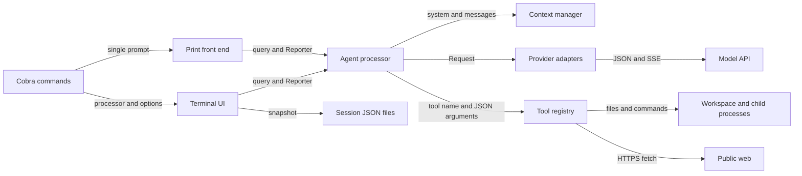
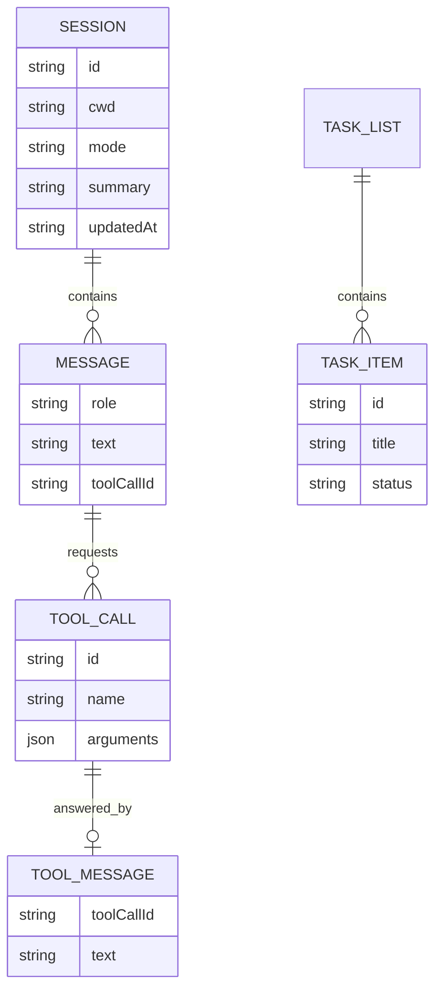
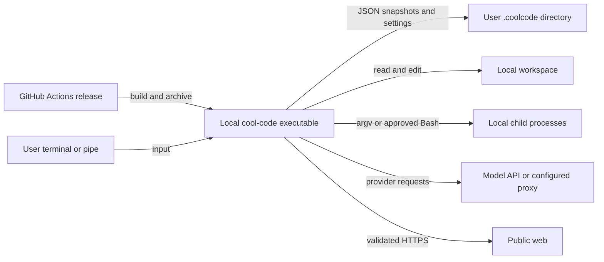

# Architecture

## Overview

Cool-Code is a local CLI process with two front ends: an interactive terminal UI and a print mode. Both construct `agent.Processor`; it owns conversation context and tool scheduling, while provider adapters translate a common message protocol into each backend's HTTP format ([cmd/root.go:109](../../cmd/root.go#L109), [cmd/print.go:58](../../cmd/print.go#L58), [processor.go:50](../../internal/agent/processor.go#L50), [llm.go:59](../../internal/llm/llm.go#L59)). Local tools operate on the current workspace; session storage is a separate UI responsibility, rather than an automatic side effect of every processor call ([app.go:429](../../internal/tui/app.go#L429)).

The edges correspond to [UI dispatch](../../internal/tui/update.go#L518), [processor requests and tool dispatch](../../internal/agent/processor.go#L163), [tool definitions](../../internal/tools/registry.go#L15), and [session persistence](../../internal/tui/app.go#L429). Explore agents live inside the processor process; they are additional model conversations, not remote workers ([subagent.go:49](../../internal/agent/subagent.go#L49)).

## Components

| Component | Responsibility | Lives in | Main collaborators |
| --- | --- | --- | --- |
| Command front ends | Parse flags; route interactive, print, config, scan, skill, and task commands. | [cmd/](../../cmd), [file map](03-structure.md#cmd) | Config, agent, TUI, session |
| Terminal UI | Input, rendering, mode changes, approval overlays, cancellation, connection setup, and snapshot saves. | [internal/tui/](../../internal/tui), [file map](03-structure.md#internal-tui) | Agent Reporter, credentials, session |
| Agent | Context construction, model/tool loop, task list, queue, compaction, and explore subagents. | [internal/agent/](../../internal/agent), [file map](03-structure.md#internal-agent) | LLM, tools, project, memory, skills |
| Provider adapters | Common request/message types, provider selection, HTTP/SSE transport, model metadata. | [internal/llm/](../../internal/llm), [file map](03-structure.md#internal-llm) | Config, credentials, external model API |
| Tool execution | JSON-schema tools, read/write policy, command preparation, shell/Git/search/web operations. | [internal/tools/](../../internal/tools), [file map](03-structure.md#internal-tools) | Workspace, OS processes, public web |
| Configuration | Merge defaults and trusted settings with permitted project preferences; route config writes. | [internal/config/](../../internal/config), [file map](03-structure.md#internal-config) | CLI, agent, provider |
| Credential store | Read/write provider API keys in private JSON files. | [internal/creds/](../../internal/creds), [file map](03-structure.md#internal-creds) | Connect UI, provider selection |
| Project context | Scan project metadata and build filtered directory trees. | [internal/project/](../../internal/project), [file map](03-structure.md#internal-project) | CLI scan, context manager, tools |
| Memory and skills | Load project/global instructions; discover and install skill modules. | [internal/memory/](../../internal/memory), [internal/skills/](../../internal/skills) | Context manager, skill commands, `use_skill` |
| Output protection | Redact sensitive text and sanitize terminal control sequences. | [internal/security/](../../internal/security), [file map](03-structure.md#internal-security) | Agent, TUI, CLI, tools |
| Session store | Persist/load/list conversation snapshots by UUID and working directory. | [internal/session/](../../internal/session), [file map](03-structure.md#internal-session) | CLI resume, TUI |
| Shared domain types | Agent mode, tool result, and task-list data. | [internal/types/](../../internal/types), [file map](03-structure.md#internal-types) | Agent, tools, TUI |

## Boundaries and contracts

- **UI ↔ processor:** `ProcessQuery(context.Context, string, Reporter)` returns final text/error; Reporter methods may run on processor or subagent goroutines. The TUI bridge converts callbacks into Bubble Tea messages and approvals into request/response channels ([processor.go:22](../../internal/agent/processor.go#L22), [app.go:46](../../internal/tui/app.go#L46)).
- **Processor ↔ model:** `Request` carries system text, messages, and tool schemas; `Message` carries text, usage, and tool calls. Tool results reference the originating call ID. `Streamer` is optional; for example, OpenAI translates this into Chat Completions JSON and assembles SSE fragments ([llm.go:28](../../internal/llm/llm.go#L28), [llm.go:59](../../internal/llm/llm.go#L59), [openai.go:29](../../internal/llm/openai.go#L29), [openai.go:129](../../internal/llm/openai.go#L129)).
- **Processor ↔ tool:** each tool declares a name, JSON schema, execution function, and `Mutating`/`ReadOnly` flags. A result separates model-facing content, human-facing display, and failure status. The processor gates modes and approvals; `RunReadOnly` additionally enforces capability at dispatch ([tools.go:44](../../internal/tools/tools.go#L44), [types.go:18](../../internal/types/types.go#L18), [processor.go:225](../../internal/agent/processor.go#L225), [registry.go:67](../../internal/tools/registry.go#L67)).
- **Trusted settings ↔ project:** configuration loads defaults, then user settings, then a restricted project overlay. Provider identity, credentials selection, endpoints, and confirmation policy cannot be selected by project configuration; the project may add read-block patterns ([config.go:89](../../internal/config/config.go#L89), [config.go:202](../../internal/config/config.go#L202), [config.go:292](../../internal/config/config.go#L292)).
- **Credentials ↔ endpoint:** precedence is explicit `llm.apiKeyEnv`, then process `COOLCODE_API_KEY`, then stored provider credentials, then the provider environment variable. A custom endpoint stops before the last two fallbacks, requiring an explicitly selected key. Configured base URL takes precedence over endpoint environment variables ([llm.go:167](../../internal/llm/llm.go#L167), [llm.go:211](../../internal/llm/llm.go#L211)).
- **Tool ↔ filesystem/process:** file tools resolve canonical paths inside granted roots and apply protected-write/read rules. Shell execution uses approved command text, a filtered environment, and a timeout; these application checks are not an OS sandbox around arbitrary commands ([safety.go:71](../../internal/tools/safety.go#L71), [safety.go:103](../../internal/tools/safety.go#L103), [shell.go:23](../../internal/tools/shell.go#L23), [shell.go:49](../../internal/tools/shell.go#L49)).
- **Tool ↔ network:** public web tools use a separate HTTPS client that validates redirects and resolves allowed IPs at connection time; this is distinct from the trusted model endpoint client, whose redirects are disabled ([network_safety.go:12](../../internal/tools/network_safety.go#L12), [http.go:21](../../internal/llm/http.go#L21)).

## Data model

These are Go structs and serialized JSON, not relational database tables. The diagram shows logical containment and tool-call/result pairing ([session.go:16](../../internal/session/session.go#L16), [llm.go:28](../../internal/llm/llm.go#L28)).

`TOOL_MESSAGE` is the role=`tool` case of `Message`, not another Go type. The task list is live processor/UI state; the session struct has no dedicated task-list field ([types.go:38](../../internal/types/types.go#L38), [processor.go:60](../../internal/agent/processor.go#L60), [session.go:16](../../internal/session/session.go#L16)).

| Entity | Storage | Key fields | Definition |
| --- | --- | --- | --- |
| Conversation snapshot | Per-session JSON | ID, cwd, mode, messages, summary, pinned file paths, extra directories | [session.go:16](../../internal/session/session.go#L16) |
| Message/tool call | In-memory history, serialized inside snapshot | Role, text, call IDs, raw JSON arguments, usage | [llm.go:28](../../internal/llm/llm.go#L28) |
| Task list | Processor and UI memory | Goal, item ID/title/status/detail | [types.go:38](../../internal/types/types.go#L38) |
| Configuration | Global/project JSON, merged in memory | LLM, features, guardrails | [config.go:13](../../internal/config/config.go#L13) |
| Credential entry | Private user JSON | Provider → API key | [creds.go:11](../../internal/creds/creds.go#L11) |
| Skill | Directory with Markdown | Name, description, body, file path | [skills.go:12](../../internal/skills/skills.go#L12) |
| Project scan | Optional workspace JSON cache | Entrypoints, frameworks, scripts, languages, timestamp | [scan.go:11](../../internal/project/scan.go#L11) |

## State and persistence

| Durable location | Contents and lifecycle | Evidence |
| --- | --- | --- |
| `~/.coolcode/settings.json` | Trusted user settings; config writes choose scope per key. | [config.go:80](../../internal/config/config.go#L80), [config.go:158](../../internal/config/config.go#L158) |
| Workspace `.coolcode.json` | Permitted project preferences. | [config.go:75](../../internal/config/config.go#L75), [config.go:93](../../internal/config/config.go#L93) |
| `~/.coolcode/credentials.json` | Provider keys; directory/file modes 0700/0600 and symlink checks. | [creds.go:21](../../internal/creds/creds.go#L21), [creds.go:60](../../internal/creds/creds.go#L60) |
| `~/.coolcode/sessions/<uuid>.json` | Interactive session snapshots; successful/cancelled turns and quit trigger saves. | [session.go:28](../../internal/session/session.go#L28), [update.go:112](../../internal/tui/update.go#L112), [update.go:543](../../internal/tui/update.go#L543) |
| Workspace `.coolcode.scan.json` | Optional scan cache; `scan --refresh` recomputes it; replacement uses a temporary file and rename. | [cmd/scan.go:26](../../cmd/scan.go#L26), [cmd/scan.go:100](../../cmd/scan.go#L100) |
| Workspace/global `COOLCODE.md` | Project instructions, with global fallback; loaded at context construction. | [memory.go:15](../../internal/memory/memory.go#L15), [context.go:40](../../internal/agent/context.go#L40) |
| Workspace/global `.coolcode/skills/` | Installed skill directories; project name collisions win. | [skills.go:22](../../internal/skills/skills.go#L22), [skills.go:70](../../internal/skills/skills.go#L70) |

The context manager keeps the current message list, summary, directory trees, catalog, pins, and extra roots in memory ([context.go:22](../../internal/agent/context.go#L22)). Pinned paths are persisted; their file contents are reread when building system context ([context.go:163](../../internal/agent/context.go#L163)). The live task list, queued prompts, and cumulative spend are not dedicated fields in the saved snapshot; print mode neither restores nor saves a session ([processor.go:60](../../internal/agent/processor.go#L60), [session.go:16](../../internal/session/session.go#L16), [cmd/print.go:25](../../cmd/print.go#L25)).

## Deployment

The release workflow cross-builds Linux and macOS amd64/arm64 plus Windows amd64, creates archives/checksums/SBOMs/signatures, and publishes after the build matrix completes ([release.yml:16](../../.github/workflows/release.yml#L16), [release.yml:36](../../.github/workflows/release.yml#L36), [release.yml:77](../../.github/workflows/release.yml#L77)). The checked-in runtime wiring is a local process with outbound HTTP and filesystem persistence, without a server listener or managed datastore in this path ([main.go:6](../../main.go#L6), [root.go:80](../../cmd/root.go#L80)).

## Failure and scale

- **Model request failures:** HTTP requests have a five-minute client timeout. Transport errors and HTTP 429/5xx are retried up to three attempts; a numeric `Retry-After` is honored. Once a successful streaming response enters SSE parsing, parsing errors return directly ([http.go:21](../../internal/llm/http.go#L21), [http.go:81](../../internal/llm/http.go#L81), [http.go:152](../../internal/llm/http.go#L152), [http.go:173](../../internal/llm/http.go#L173)).
- **Tool refusal/failure:** the processor supplies result text back to the model, allowing another model decision; it does not retry all tools automatically. Cancellation closes outstanding tool-call pairs with synthetic results so later requests remain well formed ([processor.go:154](../../internal/agent/processor.go#L154), [processor.go:342](../../internal/agent/processor.go#L342), [context.go:97](../../internal/agent/context.go#L97)).
- **Persistence failures:** missing/corrupt session files return nil on load. Saves return errors, but the TUI ignores them; snapshots use direct writes rather than a transactional database ([session.go:46](../../internal/session/session.go#L46), [session.go:77](../../internal/session/session.go#L77), [app.go:429](../../internal/tui/app.go#L429)).
- **Concurrency:** approved read calls and explore agents share a goroutine batch; mutations run sequentially afterward, and results are appended in original call order. There is no configured worker cap in this loop. Each explore conversation is limited to 15 model iterations; the parent loop has no iteration counter ([processor.go:159](../../internal/agent/processor.go#L159), [processor.go:251](../../internal/agent/processor.go#L251), [processor.go:320](../../internal/agent/processor.go#L320), [subagent.go:60](../../internal/agent/subagent.go#L60)).
- **Growth limits:** conversation selection uses estimated token counts and compaction; neither enforces a hard total provider-request size. Provider latency/rate limits, prompt growth, and local command duration are likely practical limits, inferred from these synchronous request/batch boundaries rather than measured benchmarks ([context.go:190](../../internal/agent/context.go#L190), [processor.go:428](../../internal/agent/processor.go#L428), [shell.go:129](../../internal/tools/shell.go#L129)).

See [Flow](02-flow.md) for the execution sequence and [Decisions](05-decisions.md) for the tradeoffs behind these boundaries.
