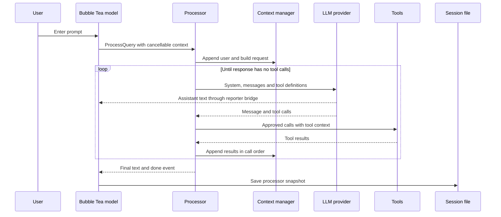
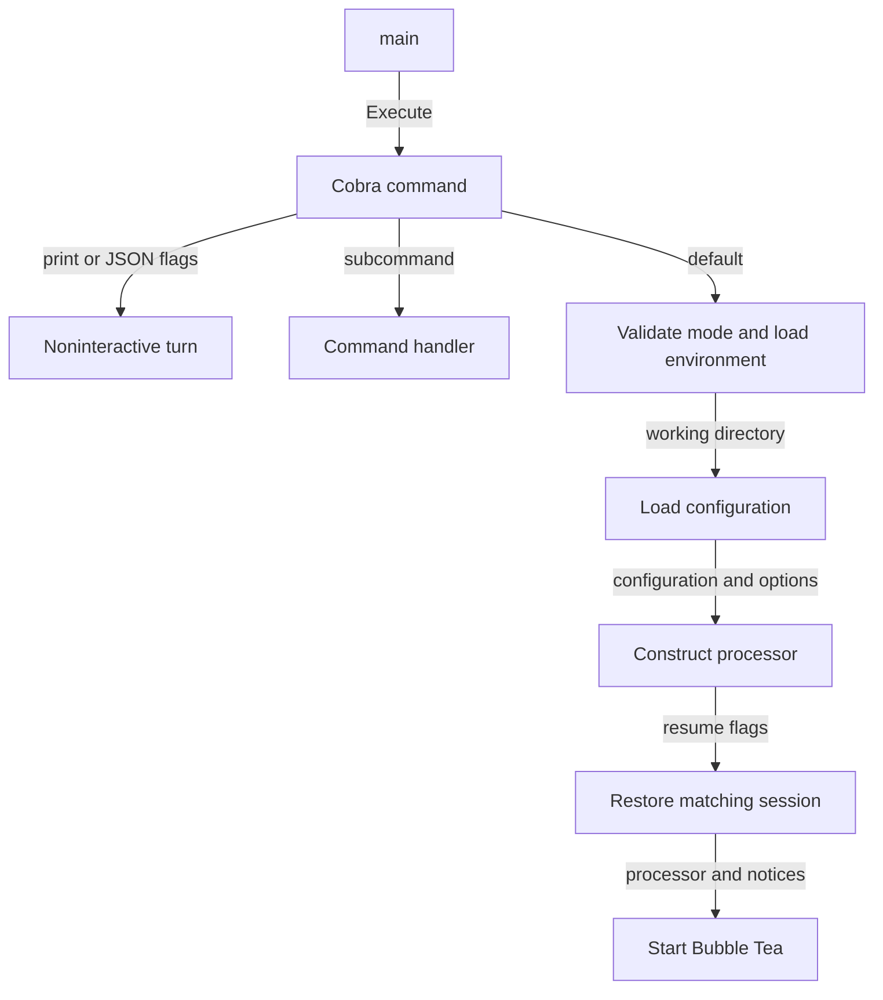
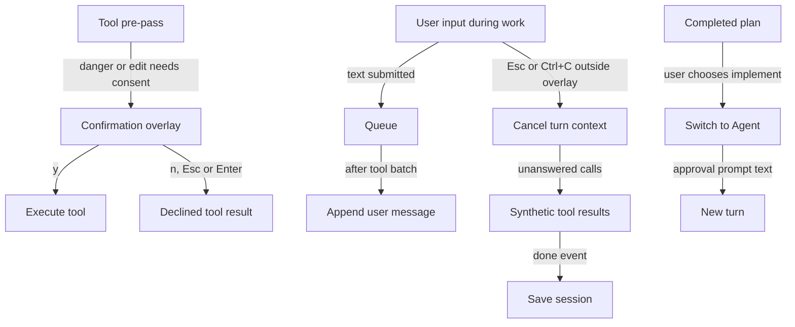
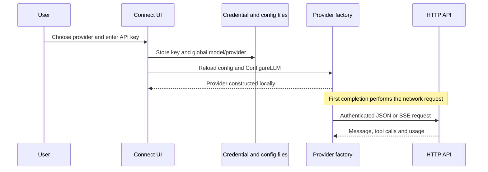
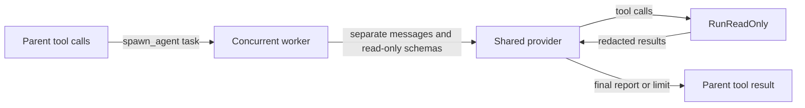
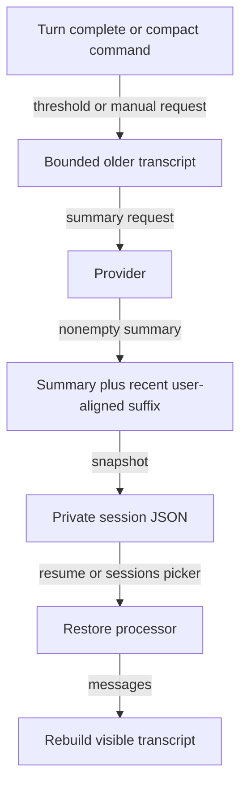
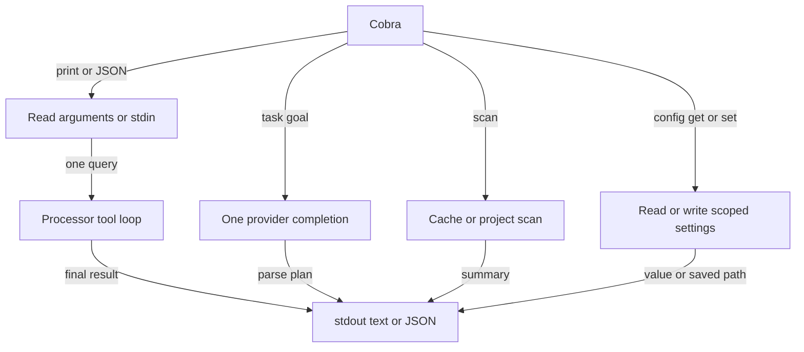
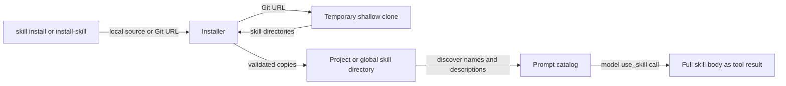
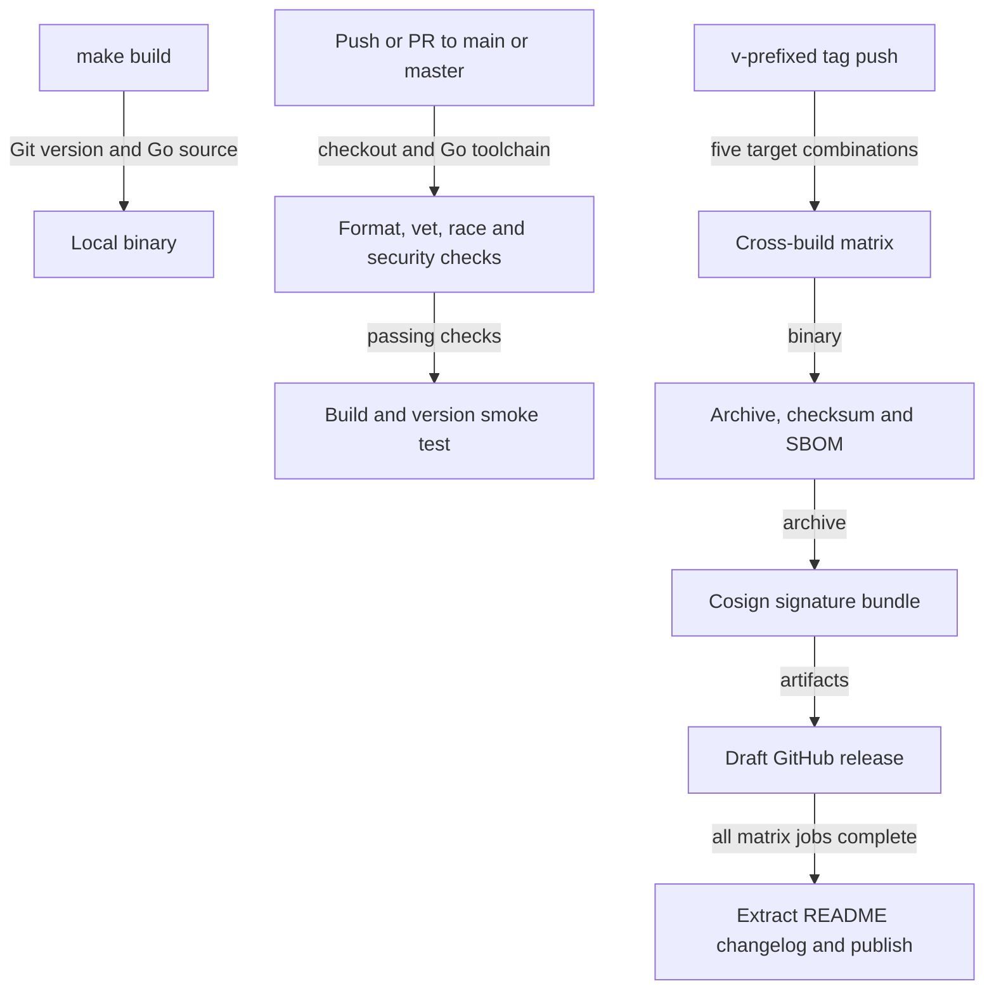

# Flow

## Interactive turn

The main runtime path is terminal input → `Processor.ProcessQuery` → provider completion → guarded tools → another completion → transcript and session snapshot. The UI forwards events; the processor owns conversation and tool execution ([processor.go:146](../../internal/agent/processor.go#L146), [app.go:46](../../internal/tui/app.go#L46)).

1. **Submit or dispatch.** Enter reaches `submit`, which clears the composer and records input history. During a running turn it queues the input; when idle, slash-prefixed text goes to the command dispatcher and ordinary text goes to `runQuery`. [`update.go:496`](../../internal/tui/update.go#L496) · [structure](03-structure.md#internal-tui)
2. **Start work outside the UI loop.** `runQuery` appends the user entry, creates a cancellable context, and returns a Bubble Tea command that invokes `ProcessQuery`. The reporter bridge sends status, streamed text, tool results, tasks, and subagent updates back as UI messages. [`update.go:518`](../../internal/tui/update.go#L518), [`app.go:46`](../../internal/tui/app.go#L46) · [structure](03-structure.md#internal-tui)
3. **Build the request.** A missing provider fails before adding the user message. Otherwise the context manager stores redacted user text and combines the base/mode prompts, marked-untrusted project instructions and skill catalog, tree, allowed pinned files, and earlier summary. It selects a trailing conversation window beginning at a user message. [`processor.go:146`](../../internal/agent/processor.go#L146), [`context.go:70`](../../internal/agent/context.go#L70), [`context.go:140`](../../internal/agent/context.go#L140), [`context.go:190`](../../internal/agent/context.go#L190) · [structure](03-structure.md#internal-agent)
4. **Call the backend.** The processor uses `Streamer` when supported and a reporter exists, otherwise `Complete`. Provider-neutral requests and results cross the `Provider` interface; each adapter translates the payload. The OpenAI adapter, for example, assembles streamed tool-call fragments by index. [`processor.go:163`](../../internal/agent/processor.go#L163) · [agent structure](03-structure.md#internal-agent); [`llm.go:68`](../../internal/llm/llm.go#L68), [`openai.go:129`](../../internal/llm/openai.go#L129) · [LLM structure](03-structure.md#internal-llm)
5. **Render and retain the response.** Provider usage updates counters and the redacted response enters history. Streamed text is buffered to complete lines before redaction. A response with no tools ends the loop; text accompanying tools is retained as an intermediate assistant message. [`processor.go:182`](../../internal/agent/processor.go#L182), [`processor.go:202`](../../internal/agent/processor.go#L202), [`processor.go:723`](../../internal/agent/processor.go#L723) · [structure](03-structure.md#internal-agent)
6. **Check tool authority before execution.** The sequential pre-pass handles task-list updates, separates subagents, blocks mutating tools outside Agent mode, prepares commands, and applies danger/edit confirmation. Declines and preparation errors become tool results instead of terminating the whole turn. [`processor.go:218`](../../internal/agent/processor.go#L218), [`processor.go:377`](../../internal/agent/processor.go#L377) · [structure](03-structure.md#internal-agent)
7. **Execute and join.** Read-only calls and subagents run concurrently, then mutating calls run sequentially. Results are redacted and appended in the model's original call order; structural tools trigger a refreshed tree. The tool context carries the root, extra roots, configuration, ignore checker, and cancellation context. [`processor.go:251`](../../internal/agent/processor.go#L251), [`processor.go:320`](../../internal/agent/processor.go#L320) · [agent structure](03-structure.md#internal-agent); [`tools.go:18`](../../internal/tools/tools.go#L18) · [tools structure](03-structure.md#internal-tools)
8. **Continue or finish.** After a tool batch, queued messages enter history and the loop asks the provider again. After a final response, automatic compaction may run. `handleDone` persists a successful or cancelled turn, optionally copies the final answer, and offers an implementation menu for Plan mode. Ordinary errors render in the transcript without an immediate save in that branch. [`processor.go:359`](../../internal/agent/processor.go#L359) · [agent structure](03-structure.md#internal-agent); [`update.go:112`](../../internal/tui/update.go#L112) · [TUI structure](03-structure.md#internal-tui)

## Startup

1. **Choose an entry path.** `main` calls `cmd.Execute`; Cobra routes `--print`/`--json` to `runPrint`, ordinary invocation to `runInteractive`, and explicit subcommands to their handlers. [`main.go:6`](../../main.go#L6) · [root structure](03-structure.md#root); [`root.go:40`](../../cmd/root.go#L40) · [command structure](03-structure.md#cmd)
2. **Establish the workspace and settings.** Interactive startup validates mode, imports selected API-key-shaped variables from a regular local `.env` without overriding existing environment values, reads the current directory, and honors `--no-init` by exiting. Configuration merges defaults, global settings, and permitted project settings; CLI effort and danger flags are then applied. [`root.go:80`](../../cmd/root.go#L80), [`root.go:172`](../../cmd/root.go#L172) · [command structure](03-structure.md#cmd); [`config.go:93`](../../internal/config/config.go#L93) · [config structure](03-structure.md#internal-config)
3. **Build the processor.** `agent.New` resolves the provider, creates the ignore checker/context manager, establishes mode and tool context, and builds tool definitions. Context initialization reads project instructions, a privacy-filtered tree, and the skill catalog. Interactive startup tolerates a missing key and displays a `/connect` notice. [`processor.go:77`](../../internal/agent/processor.go#L77), [`context.go:40`](../../internal/agent/context.go#L40) · [agent structure](03-structure.md#internal-agent); [`root.go:109`](../../cmd/root.go#L109) · [command structure](03-structure.md#cmd)
4. **Restore if requested.** `--resume` loads an ID and rejects a session belonging to another directory; `--continue` selects the latest saved session for the current directory. Restore reinstates messages, summary, pins and mode, repairs dangling tool calls, and replays extra-directory grants. An explicitly requested mode wins over persisted mode. [`root.go:131`](../../cmd/root.go#L131), [`root.go:249`](../../cmd/root.go#L249) · [command structure](03-structure.md#cmd); [`processor.go:714`](../../internal/agent/processor.go#L714) · [agent structure](03-structure.md#internal-agent)
5. **Enter the terminal application.** `tui.Run` constructs the model, adds notices, reconstructs the transcript, wires confirmation callbacks through the bridge, and starts Bubble Tea in the alternate screen. [`run.go:21`](../../internal/tui/run.go#L21) · [structure](03-structure.md#internal-tui)

## Approval, cancellation, queueing, and plan handoff

1. **Wait for consent.** `gate` checks danger independently from edit confirmation. The bridge sends a request with a response channel and blocks until the UI replies. While the confirmation overlay is active, `y` approves and `n`, Esc, or Enter declines; this overlay takes precedence over ordinary cancellation key handling. [`processor.go:377`](../../internal/agent/processor.go#L377) · [agent structure](03-structure.md#internal-agent); [`app.go:61`](../../internal/tui/app.go#L61), [`update.go:154`](../../internal/tui/update.go#L154) · [TUI structure](03-structure.md#internal-tui)
2. **Cancel ongoing work.** Outside overlays, Esc or Ctrl+C during processing invokes the turn's cancellation function. Provider requests and tool execution receive that context. A deferred repair supplies synthetic results for unfinished tool calls, and the cancelled completion event saves the session. [`update.go:191`](../../internal/tui/update.go#L191), [`update.go:536`](../../internal/tui/update.go#L536), [`update.go:120`](../../internal/tui/update.go#L120) · [TUI structure](03-structure.md#internal-tui); [`processor.go:154`](../../internal/agent/processor.go#L154), [`context.go:97`](../../internal/agent/context.go#L97) · [agent structure](03-structure.md#internal-agent)
3. **Queue steering.** New submissions during processing—including slash-prefixed text—enter the processor queue, redacted before storage. The queue drains only after a completed tool batch. A response that ends without tools does not drain it or automatically launch a follow-up turn. [`update.go:507`](../../internal/tui/update.go#L507) · [TUI structure](03-structure.md#internal-tui); [`processor.go:597`](../../internal/agent/processor.go#L597), [`processor.go:359`](../../internal/agent/processor.go#L359) · [agent structure](03-structure.md#internal-agent)
4. **Turn a plan into implementation.** A successful Plan-mode answer opens the plan menu. Choosing implementation sets Agent mode and submits a new approval prompt; keeping planning closes the menu. [`update.go:141`](../../internal/tui/update.go#L141), [`update.go:300`](../../internal/tui/update.go#L300) · [structure](03-structure.md#internal-tui)

## Provider connection and HTTP transport

1. **Store a connection.** `/connect` opens a provider menu; unsupported subscription options report that sign-in is unavailable. API-key entry writes credentials, saves global model/provider defaults, reloads configuration, and reconstructs the provider. This setup does not itself verify the key with a network request. [`dispatch.go:39`](../../internal/tui/dispatch.go#L39), [`update.go:395`](../../internal/tui/update.go#L395), [`update.go:407`](../../internal/tui/update.go#L407) · [TUI structure](03-structure.md#internal-tui); [`creds.go:60`](../../internal/creds/creds.go#L60) · [credential structure](03-structure.md#internal-creds)
2. **Resolve credentials and backend.** `llm.New` uses an explicit provider or model-name inference, validates the endpoint, and resolves credentials. A configured API-key environment variable wins, then `COOLCODE_API_KEY`; custom endpoints cannot fall back to first-party stored/environment credentials. Ordinary provider endpoints then use stored credentials or the provider's environment variable. [`llm.go:129`](../../internal/llm/llm.go#L129), [`llm.go:167`](../../internal/llm/llm.go#L167) · [structure](03-structure.md#internal-llm)
3. **Send with bounded retries.** The shared HTTP client has a five-minute timeout and rejects redirects. JSON requests retry transport failures, 429, and 5xx for up to three attempts; SSE retries pre-response failures but returns directly after parsing an accepted response. Backoff honors integer `Retry-After` seconds and is cancellable. [`http.go:21`](../../internal/llm/http.go#L21), [`http.go:87`](../../internal/llm/http.go#L87), [`http.go:144`](../../internal/llm/http.go#L144), [`http.go:173`](../../internal/llm/http.go#L173) · [structure](03-structure.md#internal-llm)

## Read-only subagents

1. **Fan out from the parent.** The parent places `spawn_agent` calls beside read-only tool workers, reports progress lines, waits for all workers, and inserts each report in original tool-call order. [`processor.go:251`](../../internal/agent/processor.go#L251) · [structure](03-structure.md#internal-agent)
2. **Use isolated conversation state.** Each worker starts with its task, the subagent prompt, project tree, and extra-directory list, while sharing the parent's provider and allowed tool context. It exposes only the registry's read-only tools; `spawn_agent` is absent, so nested delegation is unavailable. [`subagent.go:35`](../../internal/agent/subagent.go#L35), [`subagent.go:49`](../../internal/agent/subagent.go#L49) · [structure](03-structure.md#internal-agent)
3. **Bound the exploration.** A worker completes at the first response without tools, cancellation, provider error, or 15 iterations. Tool results are redacted before another request. Errors and iteration-limit notices become report text for the parent. [`subagent.go:60`](../../internal/agent/subagent.go#L60) · [structure](03-structure.md#internal-agent)

## Compaction, persistence, and resume

1. **Select older history.** After a normal turn, `summarize` checks the configured message-count threshold; `/compact` calls the manual path. The summary request includes the previous summary and up to 24,000 estimated tokens of older textual messages, excluding the latest 20. [`processor.go:414`](../../internal/agent/processor.go#L414), [`processor.go:428`](../../internal/agent/processor.go#L428), [`context.go:269`](../../internal/agent/context.go#L269), [`context.go:290`](../../internal/agent/context.go#L290) · [agent structure](03-structure.md#internal-agent); [`dispatch.go:170`](../../internal/tui/dispatch.go#L170) · [TUI structure](03-structure.md#internal-tui)
2. **Apply only a usable summary.** Provider errors or empty summaries leave history intact. Success stores a redacted summary and trims toward the latest 20 messages, advancing to a real user message to avoid a partial tool round; if that suffix has no user message, history is retained. Thus the retained count is not guaranteed to equal 20. [`processor.go:441`](../../internal/agent/processor.go#L441), [`context.go:319`](../../internal/agent/context.go#L319) · [structure](03-structure.md#internal-agent)
3. **Save a snapshot.** TUI success, cancellation, compaction events, and quit call `persist`. It serializes messages, summary, mode, pins, extra roots, directory, and timestamp. `session.Save` validates the UUID and rejects symlink storage paths, then writes a mode-0600 file under a mode-0700 sessions directory. The TUI ignores save errors. [`app.go:429`](../../internal/tui/app.go#L429), [`update.go:47`](../../internal/tui/update.go#L47), [`update.go:544`](../../internal/tui/update.go#L544) · [TUI structure](03-structure.md#internal-tui); [`session.go:46`](../../internal/session/session.go#L46) · [session structure](03-structure.md#internal-session)
4. **Restore saved state.** Startup resume is described above; `/sessions` lists at most ten current-directory sessions and restores the selected snapshot, replays extra roots, and reconstructs the transcript. [`dispatch.go:176`](../../internal/tui/dispatch.go#L176), [`update.go:368`](../../internal/tui/update.go#L368) · [TUI structure](03-structure.md#internal-tui); [`session.go:101`](../../internal/session/session.go#L101) · [session structure](03-structure.md#internal-session)

## Noninteractive commands

1. **Print mode.** Positional arguments take precedence over piped stdin. `runPrint` loads configuration, constructs a processor requiring a key, installs confirmation handlers that approve only when the CLI `--allow-dangerous` flag was supplied, and runs one turn. It emits the final text or JSON metadata, with optional tool activity on stderr. It does not use interactive session restore/save. [`print.go:25`](../../cmd/print.go#L25), [`print.go:104`](../../cmd/print.go#L104) · [structure](03-structure.md#cmd)
2. **Task planning.** `task <goal>` constructs a provider directly and requests one structured JSON plan with no processor, project tree, or tools. It tolerates code fences/preamble during parsing and prints a plan or a rephrasing suggestion. [`task.go:17`](../../cmd/task.go#L17) · [command structure](03-structure.md#cmd); [`taskplan.go:44`](../../internal/agent/taskplan.go#L44) · [agent structure](03-structure.md#internal-agent)
3. **Project scan.** `scan` reads a valid cache unless refresh is requested or caching disabled, otherwise runs `ScanProject`, optionally writes the cache, and prints JSON or text. This is local inspection: known entrypoint paths, package scripts/dependencies, config-file presence, and file extensions feed the summary. [`scan.go:17`](../../cmd/scan.go#L17) · [command structure](03-structure.md#cmd); [`scan.go:55`](../../internal/project/scan.go#L55) · [project structure](03-structure.md#internal-project)
4. **Configuration.** `config get` reads the merged effective configuration. `config set` parses a value, chooses project or global storage by key, writes it, and reports the actual path; model/provider/endpoint/credential, confirmation, and guardrail settings are global-only. [`config.go:13`](../../cmd/config.go#L13) · [command structure](03-structure.md#cmd); [`config.go:158`](../../internal/config/config.go#L158), [`config.go:202`](../../internal/config/config.go#L202) · [config structure](03-structure.md#internal-config)

## Skill installation and loading

1. **Install source material.** CLI `skill install` and TUI `/install-skill` call the same Go installer. It recognizes local files/directories or Git URLs, shallow-clones remote sources with a timeout and restricted subprocess environment, finds supported `SKILL.md` layouts, and installs under project `.coolcode/skills` or global `~/.coolcode/skills`. The TUI refreshes its catalog after success. [`skill.go:13`](../../cmd/skill.go#L13) · [command structure](03-structure.md#cmd); [`dispatch.go:188`](../../internal/tui/dispatch.go#L188) · [TUI structure](03-structure.md#internal-tui); [`installer.go:92`](../../internal/skills/installer.go#L92) · [skills structure](03-structure.md#internal-skills)
2. **Discover and advertise.** Discovery visits project before global directories, so a project skill wins a name collision. The catalog supplies names/descriptions; `Body` rediscovers and returns a selected skill's body when requested. [`skills.go:70`](../../internal/skills/skills.go#L70), [`skills.go:106`](../../internal/skills/skills.go#L106), [`skills.go:120`](../../internal/skills/skills.go#L120) · [structure](03-structure.md#internal-skills)
3. **Load in a model turn.** The registered `use_skill` tool fetches a body and returns it as instruction-prefixed text. That result follows the normal redacted tool-result path back to the provider; unlike the catalog, this body is not wrapped in untrusted-content markers here. [`misc_tools.go:96`](../../internal/tools/misc_tools.go#L96) · [tools structure](03-structure.md#internal-tools); [`processor.go:342`](../../internal/agent/processor.go#L342) · [agent structure](03-structure.md#internal-agent)

## Build and release

1. **Build locally.** `make build` derives a version with `git describe`, strips its leading `v`, and invokes `go build -trimpath` with symbol stripping and an injected `cmd.Version`, producing `./cool-code`. `make install` uses equivalent flags with `go install`. [`Makefile:1`](../../Makefile#L1), [`Makefile:9`](../../Makefile#L9) · [structure](03-structure.md#root)
2. **Validate branch changes in CI.** Pushes and pull requests targeting `main` or `master` run on Ubuntu with a read-only repository token. The job checks out source, selects Go from `go.mod`, checks formatting, runs vet and race tests, installs pinned Gosec/Govulncheck tools, then runs both security checks. [`ci.yml:3`](../../.github/workflows/ci.yml#L3), [`ci.yml:17`](../../.github/workflows/ci.yml#L17), [`ci.yml:25`](../../.github/workflows/ci.yml#L25) · [workflow structure](03-structure.md#github); [`Makefile:21`](../../Makefile#L21) · [security-check configuration](03-structure.md#root)
3. **Smoke-test the CLI build.** After CI checks pass, the job builds the binary and executes `--version`. This CI build uses `-trimpath` but does not inject the Makefile's Git-derived version. [`ci.yml:44`](../../.github/workflows/ci.yml#L44) · [structure](03-structure.md#github)
4. **Cross-build a tagged release.** A `v*` tag independently triggers the release workflow. Its matrix builds Linux amd64/arm64, macOS amd64/arm64 and Windows amd64; each job selects Go from the module, removes `v` from the tag for version injection, and packages the binary in `.tar.gz` with a SHA-256 checksum. The workflow has no dependency on the separate CI workflow's result. [`release.yml:3`](../../.github/workflows/release.yml#L3), [`release.yml:16`](../../.github/workflows/release.yml#L16), [`release.yml:36`](../../.github/workflows/release.yml#L36) · [structure](03-structure.md#github)
5. **Generate provenance artifacts and upload a draft.** Each matrix job generates an SPDX JSON SBOM, installs Cosign, signs its archive into a Sigstore bundle, and uploads archive, checksum, SBOM and signature bundle to a draft release. The workflow grants content writes and OIDC token writes. [`release.yml:8`](../../.github/workflows/release.yml#L8), [`release.yml:52`](../../.github/workflows/release.yml#L52), [`release.yml:61`](../../.github/workflows/release.yml#L61), [`release.yml:67`](../../.github/workflows/release.yml#L67) · [structure](03-structure.md#github)
6. **Publish only after the matrix finishes.** The publish job depends on the release matrix, extracts the README section headed `### <version>:` for the tag's version, requires nonempty notes, and uses `gh release edit` to publish the draft and mark it latest. Missing or differently formatted changelog notes stop this final step. [`release.yml:77`](../../.github/workflows/release.yml#L77), [`release.yml:88`](../../.github/workflows/release.yml#L88) · [workflow structure](03-structure.md#github); [README changelog example](../../README.md#L262) · [root structure](03-structure.md#root)
